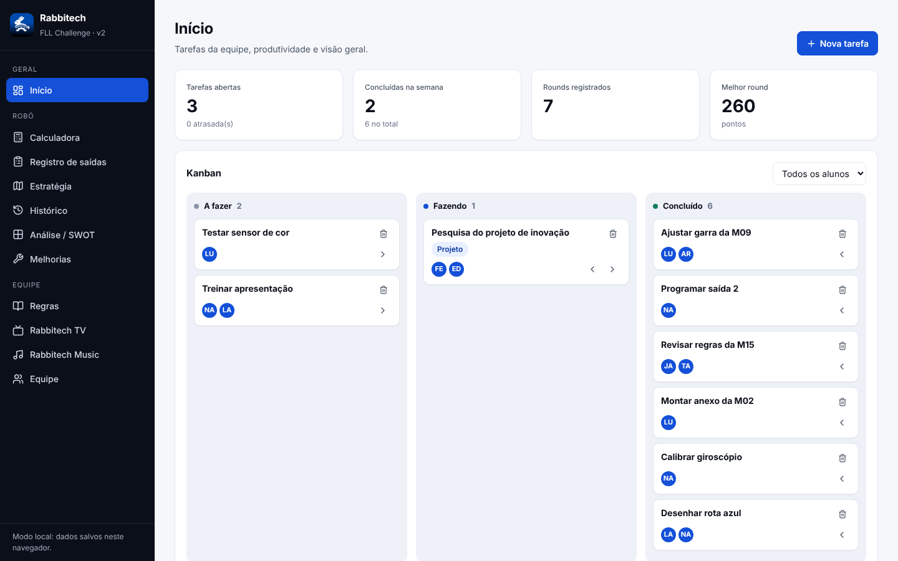
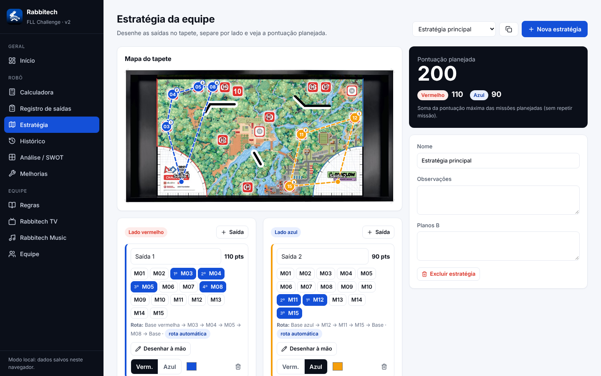
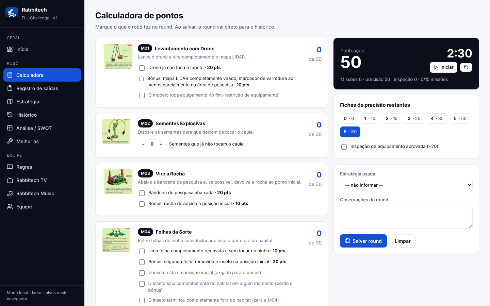
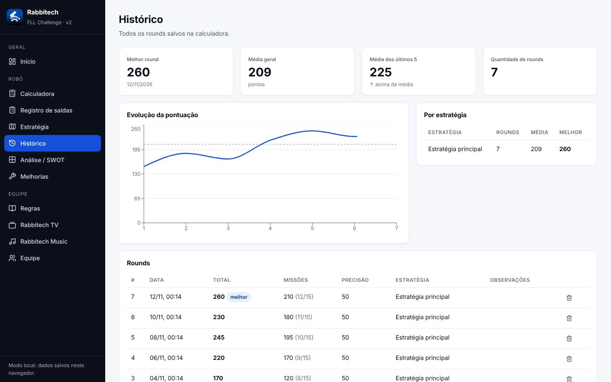

<div align="center">


# Rabbitech — Plataforma da equipe FLL

Organização, estratégia e treinos da equipe **Rabbitech** na FIRST LEGO League Challenge (temporada BIOGLOW).

**[sistema-rabbitech.vercel.app](https://sistema-rabbitech.vercel.app)**

</div>

A versão antiga continua em [Rabbitech-calculator-first-lego-league](https://github.com/lnzindev/Rabbitech-calculator-first-lego-league), para mostrar a evolução.

| Início (Kanban e produtividade) | Estratégia (rotas no tapete) |
| --- | --- |
|  |  |
| **Calculadora de pontos** | **Histórico de rounds** |
|  |  |

## Telas

| Menu | O que faz |
| --- | --- |
| **Início** | Kanban (tarefas para alunos ou grupos), gráfico de produtividade por aluno e por semana |
| **Calculadora** | Pontuação das 15 missões + cronômetro 2:30; salva o round no histórico com a estratégia usada |
| **Registro de saídas** | Cada teste do robô: missões, funcionou (sim/parcial/não), tempo gasto, quem testou e observação |
| **Estratégia** | Várias estratégias; saídas no lado vermelho/azul, missões marcadas no tapete com rota automática (ou desenhada à mão), pontuação por lado e total, planos B |
| **Histórico** | Melhor round, média, quantidade, evolução e comparação por estratégia |
| **Análise / SWOT** | Taxa de sucesso por missão e quadro SWOT |
| **Melhorias** | Registro de mudanças no robô (antes → depois → resultado) |
| **Código do robô** | Programação Pybricks do GitHub: ver, baixar (.zip ou arquivo), editar e publicar pelo site, histórico e redeploy |
| **Regras** | Caderno de regras e passo a passo da montagem do tapete (PDF/imagem/link) |
| **Rabbitech TV** | Busca no YouTube com filtro preciso, vídeos fixados por tema, anotações e playlists da equipe |
| **Rabbitech Music** | Músicas do YouTube (sem login, música inteira): busca, favoritas, playlists que tocam em sequência e player flutuante que continua em outras telas |
| **Equipe** | Alunos e grupos |

Removidos da v1: ranking público e o player de música antigo.

## Documentação

| Guia | Conteúdo |
| --- | --- |
| [Estrutura do projeto](docs/ESTRUTURA.md) | o que tem em cada pasta e onde mexer |
| [Configuração](docs/CONFIGURACAO.md) | Supabase, Vercel, liberar alunos, chaves do YouTube e do Spotify |
| [Testes automáticos](docs/TESTES.md) | robô que explora o site e gera relatório |

## Rodar no computador

```bash
npm install
npm run dev
```

Sem configurar nada, o `npm run dev` roda em **modo local** (dados só no navegador), bom para testar.

## Tecnologia

React 18 + Vite · React Router · Recharts · Supabase (Postgres, Auth, Storage, Realtime, Edge Functions) · Vercel · Playwright.
